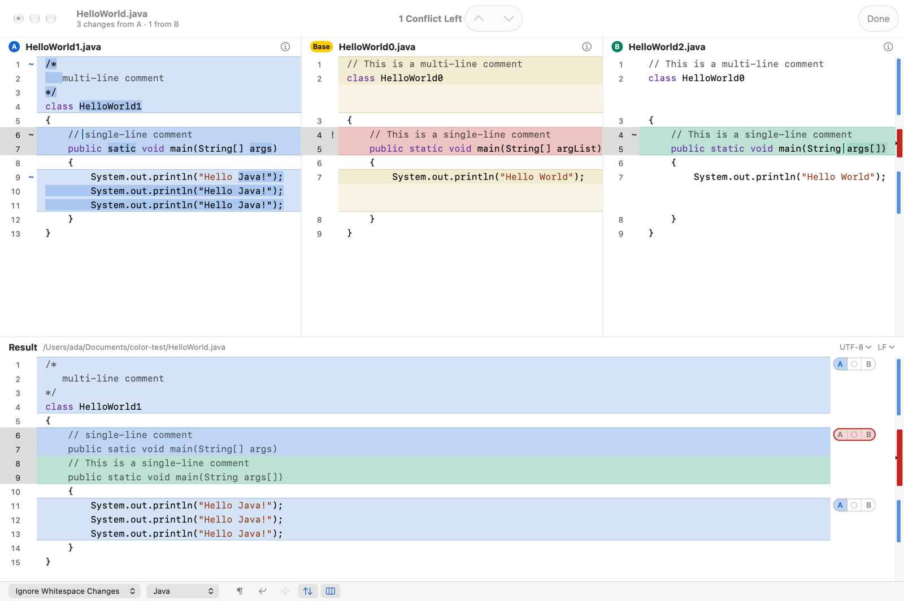
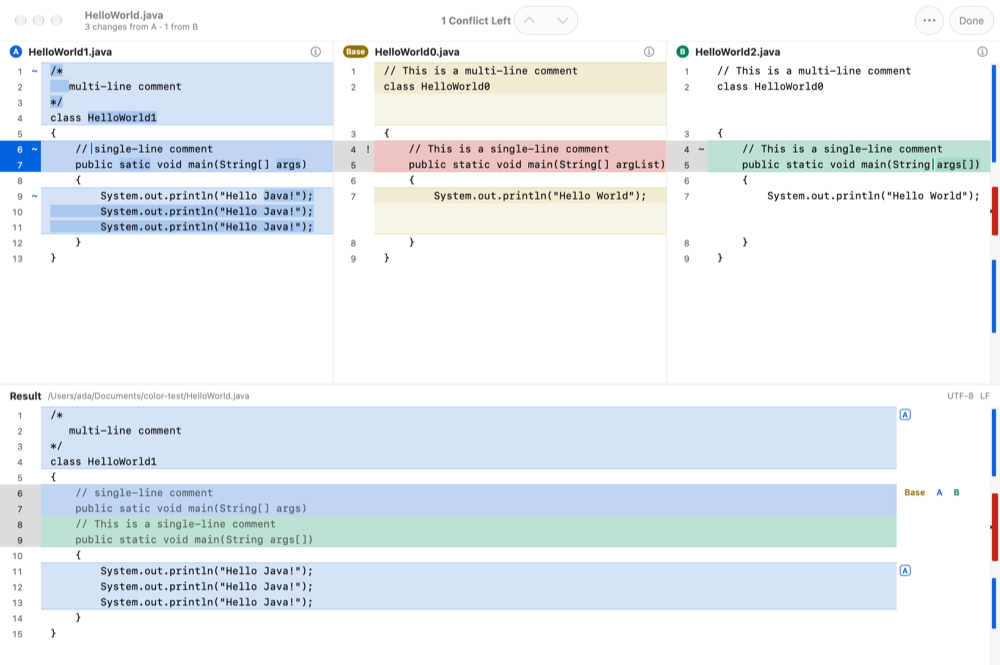
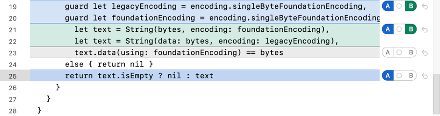
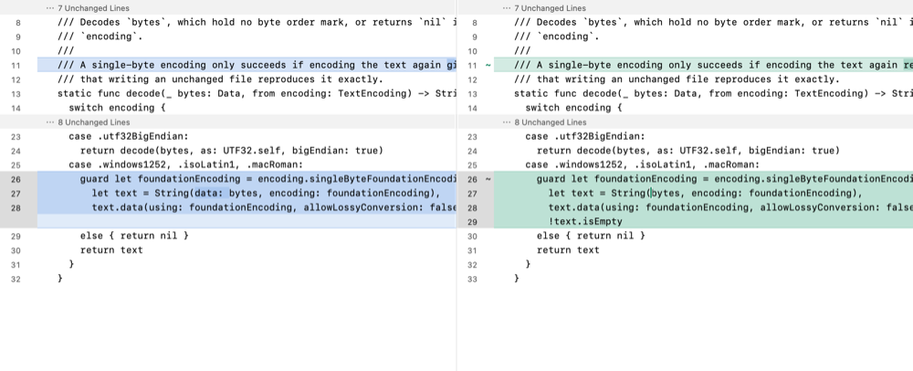

# Seamerge user guide

This guide is for people who use Seamerge to compare files and to resolve Git merge conflicts. For installing and setting up Git, see the [README](../README.md#install).

- [Merge in five minutes](#merge-in-five-minutes)
- [Reading the window](#reading-the-window)
- [The decision bar](#the-decision-bar)
- [Comparing files](#comparing-files)
- [Resolving a conflict](#resolving-a-conflict)
- [Collapsing unchanged lines](#collapsing-unchanged-lines)
- [The footer](#the-footer)
- [Saving and closing](#saving-and-closing)
- [Keyboard shortcuts](#keyboard-shortcuts)
- [Questions](#questions)

## Merge in five minutes

1. Start a merge that stops with conflicts, for example with `git merge`. Then run `git mergetool`. Seamerge opens the file.
2. The window shows four panes: A, the base, B and the result. A is the incoming side, B your side, and the base is their common ancestor. Hide the base with **Hide Base** (`⌥⌘B`). The result is what Git saves.
3. A block that is marked as a conflict has no obvious winner. Look at A and B, then take one side with the decision bar, or take both, or edit the result by hand.
4. Continue with the next conflict. The toolbar counts the conflicts that are still open, and `⌥⌘↓` moves to the next one.
5. Save with **Save and Close** (`⌘↩`). Git then continues with the next file.

A block that was changed on one side only is already decided: its change is taken. You only see it in the result, and you can still change it.

## Reading the window

- **Panes** show the sources side by side. Rows that line up across the panes are the same place in the files.
- **Tints** mark the changed text: the lines that differ are shaded, and the words that differ are highlighted within them.
- **Gutter marks** at the edge of each pane show where a block starts, and explain their meaning in a tooltip.
- **Overview bar** at the edge of the window shows where the changes are in the whole file.
- **Toolbar** shows the number of open conflicts or changes, the navigation controls and the options.
- **Pane headers** name each side. A side is named after its file, or by its letter where the file name tells nothing.

## The decision bar

The decision column between the panes holds one decision bar for each block. The decision bar, also called the pill, is a capsule with three toggles: A, Base and B. Sources with the same text share a toggle.

- Click a toggle to take that source's text into the block, or to take it out again. The text is added in the order you switch the toggles on.
- **Use A** (`⌘1`), **Use Base** (`⌘2`) and **Use B** (`⌘3`) take one source. **Use None** (`⌘6`) takes nothing, which deletes the block's text and resolves a conflict.
- Switching off the last toggle of a conflict reopens it.
- The option keys `⌥⌘1`, `⌥⌘2` and `⌥⌘3` switch the toggles A, Base and B on or off without the other toggles.

Open conflicts show their preview of A and B until you decide. You cannot type in a conflict's preview.

## Comparing files

Seamerge compares two files with `git difftool`, from Tower, or from the window **Compare Files** in the app.

- **Compare Files** lists the recent comparisons. You can also drop files on the Dock icon of Seamerge.
- Under **Compare** you choose how the files are compared:
  - **Exact** compares every byte.
  - **Ignore Line Endings** treats CRLF and LF as the same.
  - **Ignore Whitespace Changes** ignores differences in the amount of whitespace.
  - **Ignore All Whitespace** ignores all differences in whitespace.
- **Swap Sides** exchanges the left and the right file.
- **Next File** (`⌥⌘→`) and **Previous File** (`⌥⌘←`) move through the files of a collection.
- **Show Sidebar** (`⌃⌘S`) shows or hides the list of files.

### Several files in one window

When Git or Tower compares several files in one run, Seamerge puts them into one window, and the sidebar lists the files. Each file shows whether it was modified, added or deleted. The window receives the files as Git hands them over, and the sidebar says when it is still receiving. Seamerge collects the files only when Git numbers them, which `git difftool` and Tower do. Otherwise each file opens its own window.

Renames are not detected: a renamed file shows as a deleted file and a new file.

### Directory diff

`git difftool --dir-diff` compares two folders in one window. Seamerge pairs the files of the two folders by their path. A file only on one side is new or deleted. Links to files of the working tree are followed, so that the working copy is shown. Other links are compared by their target. If no file differs, no window opens.

In Tower, turn on **Perform directory diff** to compare folders.

## Resolving a conflict

1. **Jump to the next open conflict** with `⌥⌘↓`, or to the previous one with `⌥⌘↑`. In a pane above the result, `N` and `⇧N` do the same. The toolbar counts the open conflicts.
2. **Read A and B** in their panes. The base shows what both sides changed from.
3. **Choose a source in the pill.** Use A (`⌘1`), Use Base (`⌘2`), Use B (`⌘3`) or Use None (`⌘6`). The block is resolved.
4. **Take both sides** with Use A Then B (`⌘4`) or Use B Then A (`⌘5`). The text comes in the order given. Click the pill's toggles to add or remove a source later.
5. **Type by hand.** Press Return in a pane above the result, or choose **Resolve Manually** in the Merge menu. The block's preview becomes text you can edit in the result, and the block is now edited. A later choice from the pill, such as Use B, replaces what you typed with that source's text, so take care before you choose. Switching off the last toggle reopens the conflict.
6. **Resolve many at once.** The Merge menu has **Resolve All Open Conflicts with A** and **Resolve All Open Conflicts with B**. They resolve every open conflict with that side and leave edited blocks alone. Use **Reopen All Conflicts** to turn resolved conflicts back into open ones.
7. **Undo a mistake** with `⌘Z`, and redo with `⇧⌘Z`. Undo names the step, such as Use A. **Reset This Change** (`⌥⌘⌫`) and **Reset All Decisions** (`⇧⌥⌘⌫`) bring blocks back to how the merge loaded them. Reset All Decisions asks first if hand-typed text would be lost.
8. **Finish with Done.** The toolbar's **Done** button, and **Save and Close** (`⌘↩`) in the File menu, save the result and close the window. Git then takes the file as resolved and continues. **Save** (`⌘S`) saves and keeps the window open.
9. **Close without saving** with **Leave Unresolved** (`⌘.`). The window reports the merge as not done, and Git keeps the file as a conflict. `git mergetool` then reports the file as unresolved.

## Collapsing unchanged lines

Long runs of unchanged lines fold into a bar. Click the bar to expand the run, and collapse it again from the gutter.

**Collapse Unchanged Lines** folds all of them at once, and **Show All Lines** opens them all.

## The footer

The footer at the bottom of the window holds the comparison and view options, and the syntax language of the current file. Hide or show it with **Hide Footer** or **Show Footer** (`⌘/`).

## Saving and closing

- **Save** (`⌘S`) writes the result and keeps the window open.
- **Save and Close** (`⌘↩`) writes the result and closes the window. In a merge, Git then takes the result as resolved.
- **Leave Unresolved** (`⌘.`) closes the window without saving, and Git keeps the conflict. Use it when you want to resolve the file later.
- If the result is not saved and you close the window, Seamerge asks first.

The result keeps the encoding and line endings of the file, unless you choose others in the window.

If a file changes on disk while the window is open, Seamerge reloads it and keeps your decisions.

## Keyboard shortcuts

Commands with a Command or Option key work in any window. The keys without them, such as `↓`, `N` and `1`, work in a pane above the result, which is where the focus stays while you read.

| Action | Shortcut |
|---|---|
| Next or previous conflict | `⌥⌘↓`, `⌥⌘↑`; in a pane above the result `N`, `⇧N` |
| Next or previous change | `⇧⌥⌘↓`, `⇧⌥⌘↑` in a merge, `⌥⌘↓`, `⌥⌘↑` in a comparison; in a pane above the result `↓`, `↑` |
| First or last change | `Home`, `End` in a pane above the result |
| Next or previous file (collection) | `⌥⌘→`, `⌥⌘←` |
| Show or hide the sidebar | `⌃⌘S` |
| Use A, Use Base, Use B | `⌘1`, `⌘2`, `⌘3`; in a pane above the result `1`, `2`, `3` |
| Use A Then B, Use B Then A | `⌘4`, `⌘5`; in a pane above the result `4`, `5` |
| Use None | `⌘6`; in a pane above the result `6` |
| Toggle source A, Base, B of the current block | `⌥⌘1`, `⌥⌘2`, `⌥⌘3` |
| Resolve Manually | `Return` in a pane above the result |
| Reset This Change, Reset All Decisions | `⌥⌘⌫`, `⇧⌥⌘⌫` |
| Undo, Redo | `⌘Z`, `⇧⌘Z` |
| Save, Save and Close (Done) | `⌘S`, `⌘↩` |
| Leave Unresolved | `⌘.` |
| Next or previous pane | `⌃Tab`, `⇧⌃Tab` |
| Go to Line | `⌘L` |
| Show or hide the base | `⌥⌘B` |
| Maximize the result | `⌥⌘R` |
| Wrap lines | `⌥⌘L` |
| Show all lines, collapse unchanged lines | `⇧⌘L`, `⌥⇧⌘L` |
| Show or hide the footer | `⌘/` |
| Swap sides (comparison) | `⌥⌘S` |
| Zoom in, zoom out, actual size | `⌘+`, `⌘-`, `⌘0` |

The menus list every command with its shortcut.

## Questions

**Why can I not type in a conflict?**
Typing would mix your text with two versions of the code. Choose a source with the decision bar, or press Return to resolve the block by hand first.

**Why does Git still show the file as conflicted?**
The window was closed without saving, or with **Leave Unresolved**. Open it again with `git mergetool` and save with **Save and Close**.

**Can I use Seamerge without changing my Git configuration?**
Yes. The commands in `Examples/make-git-conflict.sh` pass their settings for one run only. The **Set Up Git Integration…** sheet changes the global configuration, and **Remove** restores it.

**Does Seamerge work with Tower?**
Yes. Set up the integration in Seamerge with **Set Up Git Integration…**, and tick **Add Seamerge to Tower** in the sheet. Restart Tower. In Tower's settings, under Git Config, choose Seamerge as the diff tool and as the merge tool. Tower then opens its diffs and merges in Seamerge, and with **Perform directory diff** turned on, it compares folders.
