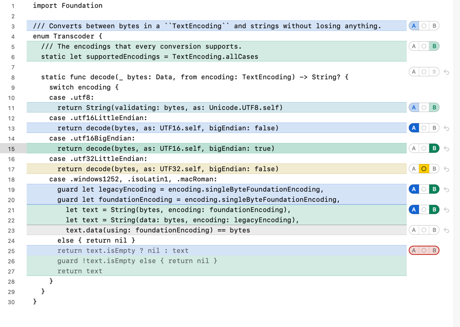
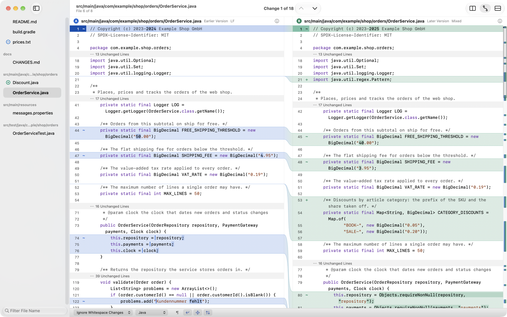
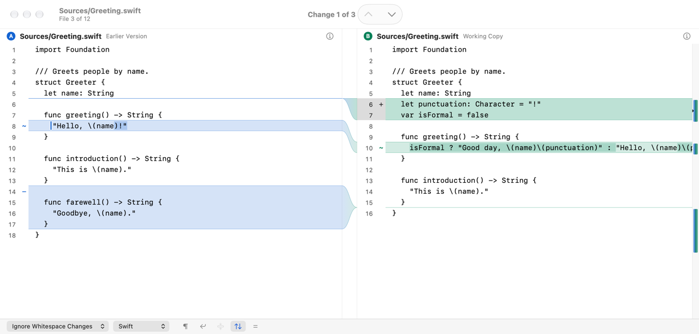

# Seamerge user guide

This guide is for people who use Seamerge to compare files and to resolve Git merge conflicts. For installing and setting up Git, see the [README](../README.md#install).

- [Merge in five minutes](#merge-in-five-minutes)
- [Reading the window](#reading-the-window)
- [The decision bar](#the-decision-bar)
- [Comparing files](#comparing-files)
- [Copying changes between the sides](#copying-changes-between-the-sides)
- [Resolving a conflict](#resolving-a-conflict)
- [Moved blocks](#moved-blocks)
- [Collapsing unchanged lines](#collapsing-unchanged-lines)
- [Line arrangements](#line-arrangements)
- [The footer](#the-footer)
- [Finding and replacing](#finding-and-replacing)
- [Ignore rules](#ignore-rules)
- [Export as patch](#export-as-patch)
- [Terminal and Finder](#terminal-and-finder)
- [Saving and closing](#saving-and-closing)
- [Settings](#settings)
- [Updates](#updates)
- [Accessibility](#accessibility)
- [Keyboard shortcuts](#keyboard-shortcuts)
- [Questions](#questions)

## Merge in five minutes

1. Start a merge that stops with conflicts, for example with `git merge`. Then run `git mergetool`. Seamerge opens the file.
2. The window shows four panes: A, the base, B and the result. A is the incoming side, B your side, and the base is their common ancestor. Hide the base with **Hide Base** (`⌥⌘B`); A and B are then compared with each other directly, as in a merge without a base. The result is what Git saves.
3. A block that is marked as a conflict has no obvious winner. Look at A and B, then take one side with the decision bar, or take both, or edit the result by hand.
4. Continue with the next conflict. The toolbar counts the conflicts that are still open, and `⌥⌘↓` moves to the next one.
5. Save with **Save and Close** (`⌘↩`). Git then continues with the next file.

A block that was changed on one side only is already decided: its change is taken. You only see it in the result, and you can still change it.

## Reading the window

- **Panes** show the sources side by side. Rows that line up across the panes are the same place in the files.
- **Tints** mark the changed text: the lines that differ are shaded, and the words that differ are highlighted within them. The tint of a block runs under the line numbers up to the text, so a block reads as one band.
- **Gutter marks** at the edge of each pane show where a block starts, and explain their meaning in a tooltip.
- **Overview bar** at the edge of the window shows where the changes are in the whole file.
- **Toolbar** shows the number of open conflicts or changes, the navigation controls and the options.
- **Pane headers** name each side. A side is named after its file, or by its letter where the file name tells nothing.

## The decision bar

The decision column between the panes holds one decision bar for each block. The decision bar, also called the pill, is a capsule with three toggles: A, Base and B. Sources with the same text share a toggle.

- Click a toggle to take that source's text into the block, or to take it out again. The text is added in the order you switch the toggles on.
- **Use A** (`⌘1`), **Use Base** (`⌘2`) and **Use B** (`⌘3`) take one source. **Use None** (`⌘6`) takes nothing, which deletes the block's text and resolves a conflict.
- Switching off the last toggle of a conflict reopens it.
- The option keys `⌥⌘1`, `⌥⌘2` and `⌥⌘3` switch the toggles A, Base and B on or off without the other toggles.

Open conflicts show their preview of A and B until you decide. You cannot type in a conflict's preview.

## Comparing files

Seamerge compares two files with `git difftool`, from Tower, or from the welcome window in the app.

- **File ▸ Compare Files…** (`⌘O`) shows the sheet Compare Files; see [The welcome window](#the-welcome-window).
- **File ▸ Compare Folders…** compares two folders in one window; see [Comparing folders in the app](#comparing-folders-in-the-app).
- Under **Compare** you choose how the files are compared:
  - **Exact** compares every byte.
  - **Ignore Line Endings** treats CRLF and LF as the same.
  - **Ignore Whitespace Changes** ignores differences in the amount of whitespace.
  - **Ignore All Whitespace** ignores all differences in whitespace.
- **Swap Sides** exchanges the left and the right file.
- **Next File** (`⌥⌘→`) and **Previous File** (`⌥⌘←`) move through the files of a collection.
- **Show Sidebar** (`⌃⌘S`) shows or hides the list of files.

### The welcome window

The welcome window appears when Seamerge starts without a task, and when you click its Dock icon while no window is open.

- **Compare Files…** (`⌘O`) shows a sheet with two fields, Left and Right, for two files or two folders.
- **Compare Folders…** shows the same sheet and asks for the left folder first.
- **Merge Files…** shows a sheet with three fields, A, Base and B.
- Drop a file on a field, or click **Choose…** in it. **Swap Sides** exchanges the outer fields. **Compare** or **Merge** opens the files in the roles shown.
- Two files or two folders dropped on the window open at once. Three files fill the sheet Merge Files. One file fills the left field of the sheet Compare Files.
- The list shows the recent comparisons under **Today** and **Earlier**, each with its kind, its folder, and the time or the day. A double click or Return opens one. A comparison whose files are gone is left out.
- The line at the bottom says whether Git uses Seamerge, with **Set Up Git Integration…** when it does not.

If the files cannot be opened, the sheet says why and keeps them.

### Several files in one window

When Git or Tower compares several files in one run, Seamerge puts them into one window, and the sidebar lists the files. Each file shows whether it was modified, added or deleted. The window receives the files as Git hands them over, and the sidebar says when it is still receiving. Seamerge collects the files only when Git numbers them, which `git difftool` and Tower do. Otherwise each file opens its own window. The window opens at once; a large file shows "Comparing…" until its lines are ready, and you can choose another file in the meantime.

Renames are not detected: a renamed file shows as a deleted file and a new file.

### Directory diff

`git difftool --dir-diff` compares two folders in one window. Seamerge pairs the files of the two folders by their path. A file only on one side is new or deleted. Links to files of the working tree are followed, so that the working copy is shown. Other links are compared by their target. If no file differs, no window opens.

In Tower, turn on **Perform directory diff** to compare folders.

### Comparing folders in the app

**File ▸ Compare Folders…** compares two folders in one window, without Git or Tower. Choose **Compare Folders…** in the welcome window or in the File menu, or drop two folders on the welcome window. The list shows the files that are new, deleted, modified, identical, or cannot be read. A file that cannot be read stays in the list with the reason. The progress of the comparison is shown above the filter. **View ▸ Show Identical Files** adds the identical files to the list. Links are not followed; their targets are compared as text.

**Filter Files** (`⇧⌘F`) narrows the list. Type in the field at the foot of the sidebar, and the list keeps the files whose name or folder contains the text, ignoring case and accents. Escape clears the field. **Next File** and **Previous File** follow the filtered list.

### Ignored changes

**View ▸ Show Ignored Changes** marks the places where the two files differ only in what the comparison ignores, such as the amount of whitespace. Each place gets a pale fill, and the whitespace in it is drawn with symbols, even when invisible characters are hidden. The menu item is enabled only when there are such places, and it changes to **Hide Ignored Changes** while they are shown. The result pane does not mark them.

### Large files

Files of up to about 100,000 lines open in about a third of a second. Jumping between changes then takes a few milliseconds, and switching the line arrangement or the comparison mode a fraction of a second. Files of around 500,000 lines, about 27 MB each, open in one to one and a half seconds; switching the comparison mode or the arrangement then takes up to a second, and Seamerge may use more than 1 GB of memory. Searching takes a fraction of a second in 100,000 lines and up to about a second in 500,000. Very long lines are the costlier case: from about 2,000 characters per line, scrolling and searching become noticeably slower. These times were measured on a Mac with an M2 Pro.

### Long lines

A line longer than 20,000 characters is shown cut off at a character boundary, followed by an ellipsis in the color of the preview. The line is shown whole as soon as the insertion point or a selection lies in it, so you can work in it. The text, copying and saving always use the whole line.

## Copying changes between the sides

In a comparison, a changed block can be copied from one file to the other. In a merge, the decision bar chooses the text of each block instead, and nothing is copied between the sides.

- **Copy to Right** (`⌥⌘→`) takes the text of the left file at the current change into the right file. **Copy to Left** (`⌥⌘←`) does the reverse.
- **Copy All Changes to Right** and **Copy All Changes to Left** copy every change of the comparison in one step. They are in the Compare menu and have no shortcut.

The seam between two panes shows a button for each change that can be copied toward a file that may be written: an arrow toward that file, or a bin where the source has no lines and the copy removes the lines of the file. The button names its change, for example "Copy Change 3 to Right". Copy to Right and Copy to Left are also in the context menu of a pane, and in a pane above the result the arrow keys `→` and `←` copy the current change. In Single Column there are no buttons, but the commands work.

**Which file can change.** A comparison that Git or Tower starts writes only the side that is the working copy, if it has one. The other sides are copies of a commit or of the index, which the next run replaces, so Seamerge does not copy into them. In a comparison of two files that you chose, each file may be written if it is an ordinary file, you may write it, and its volume is not read-only. Symbolic links are followed. In a comparison of two folders, a file must lie inside its folder. A file that cannot be written has no button, and its commands are not offered.

**What is copied.** The lines of the change in the target are replaced by the lines of the source, as its file holds them. That includes text the comparison ignores, such as whitespace or text that an ignore rule matches. The other bytes of the target stay as they are, and so do its encoding and byte order mark.

**Line endings.** In Exact mode, copied lines keep the line endings of the source, so the change is gone after the copy. In the other modes, each copied line break takes the line ending that the target uses most, unless the target has no line break. Exact mode reads a file whose line breaks are all CR as if they were LF. Lines copied from such a file take LF where the target keeps LF, and lines copied into such a file take CR where the target keeps CR.

**Characters the target cannot hold.** If the encoding of the target cannot represent a character of the copied text, the target takes the copy in UTF-8 without a byte order mark, and Save offers UTF-8 first.

**Undo.** `⌘Z` undoes a copy and names it, for example "Undo Copy to Right". It brings back the text, the current change and the collapsed runs of the window. Copy All Changes is one step.

**Saving.** A file with copied changes counts as edited until it is saved. The window header says "Edited", the file's row in the list ends with a dot, and the close button shows a dot. Undoing back past the saved state makes the file edited again. Save (`⌘S`) writes every changed file of the window, and Save and Close (`⌘↩`) writes them and closes the window. Seamerge writes the new content beside the file and then takes its place, so a failure leaves the old file as it was. Permissions stay. A symbolic link is followed, and the file it points to is written. Replacing a file breaks its hard links and makes the saving user its owner.

**Closing with changes.** Closing the window, choosing **Change Files…** or quitting with changes that are not saved asks first: Save, Don’t Save or Cancel. Quitting asks for each window that has changes.

**Changes by another program.** If another program changes a file that has copied changes, Seamerge asks first: **Keep My Version** keeps the copies, and **Reload** takes the file from disk, which is one undo step. Seamerge asks in the same way before it writes a file that another program has changed since the copy.

**What Git is told.** Git reads the outcome of each window. Closing the window after saving, or after Don’t Save, reports success, and Git goes on with the next file. **Skip Remaining Files** (`⌘.`) and quitting report failure, and Git compares no further files of the run.

## Resolving a conflict

1. **Jump to the next open conflict** with `⌥⌘↓`, or to the previous one with `⌥⌘↑`. In a pane above the result, `N` and `⇧N` do the same. The toolbar counts the open conflicts.
2. **Read A and B** in their panes. The base shows what both sides changed from.
3. **Choose a source in the pill.** Use A (`⌘1`), Use Base (`⌘2`), Use B (`⌘3`) or Use None (`⌘6`). The block is resolved.
4. **Take both sides** with Use A Then B (`⌘4`) or Use B Then A (`⌘5`). The text comes in the order given. Click the pill's toggles to add or remove a source later.
5. **Type by hand.** Press Return in a pane above the result, or choose **Resolve Manually** in the Merge menu. The block's preview becomes text you can edit in the result, and the block is now edited. A later choice from the pill, such as Use B, replaces what you typed with that source's text, so take care before you choose. Switching off the last toggle reopens the conflict.
6. **Resolve many at once.** The Merge menu has **Resolve All Open Conflicts with A** and **Resolve All Open Conflicts with B**. They resolve every open conflict with that side and leave edited blocks alone. Use **Reopen All Conflicts** to turn resolved conflicts back into open ones.
7. **Undo a mistake** with `⌘Z`, and redo with `⇧⌘Z`. Undo names the step, such as Use A. **Reset This Change** (`⌥⌘⌫`) and **Reset All Decisions** (`⌥⇧⌘⌫`) bring blocks back to how the merge loaded them. Reset All Decisions asks first if hand-typed text would be lost.
8. **Finish with Done.** The toolbar's **Done** button, and **Save and Close** (`⌘↩`) in the File menu, save the result and close the window. Git then takes the file as resolved and continues. **Save** (`⌘S`) saves and keeps the window open.
9. **Close without saving** with **Leave Unresolved** (`⌘.`). The window reports the merge as not done, and Git keeps the file as a conflict. `git mergetool` then reports the file as unresolved.

## Moved blocks

When a block of lines moved from one place to another, Seamerge marks both places, instead of showing a removal in one place and an insertion in the other as two unrelated changes.

- A move counts only for a run of lines that occurs once on each side and has at least twenty letters and digits. A closing bracket or an empty line is never a move.
- Equality follows the comparison mode you chose. A function that moved and was re-indented is a move in **Ignore Whitespace Changes**, but not in **Exact**.
- If a moved block also changed, the unchanged part is the move, and the changed lines stay removed and added.
- In a merge, a block counts as moved only when a side moved it as a whole. Blocks in a merge are never split.

At each end, a small arrow in the color of its side stands at the edge of the pane: `↓` when the other end lies further down, `↑` when it lies further up. The tooltip and VoiceOver say where the other end is, for example "Moved to line 120" or "Moved here from line 40". A click on the arrow, or **Go ▸ Go to Other End of Move**, makes the other end the current block and scrolls it into view. The command is enabled only on an end of a move. In a merge, the arrows stand only in the pane of the side that moved the block. With connected sides, each end has its own band; no band runs between the two ends. Each end counts as a change of its own. **Swap Sides** swaps the panes, and each arrow keeps pointing to where its other end now lies.

## Collapsing unchanged lines

Long runs of unchanged lines fold into a bar. Click the bar to expand the run, and collapse it again from the gutter.

**Collapse Unchanged Lines** folds all of them at once, and **Show All Lines** opens them all.

## Line arrangements

The toolbar has a segment with three arrangements: **Aligned Lines**, **Connected Sides** and **Single Column**. In a merge, the segment offers the first two. The View menu has the same three, with a checkmark on the one in use.

- **Aligned Lines** (`⌥⌘A`) is the default. The panes line up row by row, so a line sits at the same height in every pane, and the gaps fill with empty rows.
- **Connected Sides** (`⌥⇧⌘A`) shows each pane as continuous text with its own line numbers. The seam between two panes carries a band for each changed block. A band fades from the tint of one side to the tint of the other and ends where the block begins and ends in each pane. A block without lines in one pane is marked there by a hairline. When you scroll one pane, the others follow along the same blocks, so the block at the reading line stays at the same height in every pane.
- **Single Column** (`⌥⌘U`) shows both files of a comparison in one column. An unchanged line appears once. A changed block shows the lines of the left file first, then the lines of the right file. The column has one header that names both files, and each file's information button shows its path. Synchronize Scrolling is off in the column, and Go to Line goes to a line number of the right file. Single Column is not offered for a merge.

Changing the arrangement changes only the display: it keeps the current block, the insertion point, the selection and the expanded runs, and it is not an undo step. Under **New Windows** in Settings you choose the arrangement that a new comparison starts with; a new merge starts with Aligned Lines or Connected Sides.

## The footer

The footer at the bottom of the window holds the comparison and view options, and the syntax language of the current file. Hide or show it with **Hide Footer** or **Show Footer** (`⌘/`). The arrangement of the lines is chosen in the toolbar segment, described under [Line arrangements](#line-arrangements); the footer has no switch for it.

## Finding and replacing

**Find…** (`⌘F`) opens a bar above the footer that searches all panes of the window: the panes of a comparison, or A, the base, B and the result of a merge. The matches are marked as stripes in the overview bars, and VoiceOver announces the count, for example "12 matches in 3 panes", or "No matches".

- **Find Next** (`⌘G`) and **Find Previous** (`⇧⌘G`) move from match to match. In a merge they go block by block through A, the base, B and then the result, and skip a base that is hidden. In a comparison they go through the left file and then the right one. A jump makes the block of the match the current block and expands a collapsed run that holds it.
- **Use Selection for Find** (`⌘E`) searches for the selected text.
- **Find and Replace…** (`⌥⌘F`) is available in a merge. It opens the bar with a field for the replacement, and the bar replaces in the result only; A, the base and B are never changed. The checkbox **Replace** on the bar switches between replacing in the result and searching all panes. In a comparison, the command is not available.
- **Replace All** in the Edit menu, under Find, replaces every match in the result as one undo step. It has no shortcut. It is available while the bar searches the result and the last search found matches.

When you change the text of a pane, the marks of the search go away until the search text changes or you press `⌘F` again.

## Ignore rules

A comparison can leave out text that a rule matches. Where two files differ only in such text, the window does not show a difference there. **View ▸ Show Ignored Changes** marks those places, as described under [Ignored changes](#ignored-changes).

The rules are kept in **Seamerge ▸ Settings…**, on the page **Ignored Text**:

- Three rules come with the app: **Timestamps** (dates and times of day), **UUIDs** and **Memory Addresses** (such as `0x7ff8…`). Each one has a checkbox to switch it on or off.
- Add your own rule with **+**, copy one with **Duplicate**, and remove one with **−**. A rule has a name and a pattern. The pattern is a regular expression. An invalid pattern is marked with a warning sign that gives the reason, and the rule has no effect until the pattern is valid. A new rule starts switched on. An empty pattern has no effect yet and shows no warning.
- **Try the selected rule:** a field below the table takes sample text. The text that the selected rule matches is marked there, also when the rule is switched off.
- A rule that takes more than one second on one file has no effect on that file.

**Compare ▸ Use Ignore Rules** applies the switched-on rules to the window. The command is valid only when a switched-on rule takes effect, and it is off in a merge, which compares all text. Its checkmark shows the state of the window. While it is on, changing the rules in Settings compares the window again and keeps the current block. Switching it on or off is one undo step. When the rules have passed over a difference, the subtitle of the window says **Ignore rules applied**.

## Export as patch

**File ▸ Export as Patch…** saves the changes of a comparison as a unified diff in a `.patch` file. **Edit ▸ Copy as Patch** copies the same text. In a window of several files, the patch holds every changed file in the order of the list, whatever the filter shows. Swap Sides turns the patch around.

The patch records every byte of the files, whatever the comparison mode. A patch of a window that ignores whitespace still produces the new file exactly. The commands are valid only where the two files differ in their bytes.

To apply a patch, run `git apply change.patch` in the repository, or use `patch -p1 < change.patch`. The `patch` that comes with macOS understands the names that Git writes for ordinary paths. It does not understand a path that Git quotes, such as one with letters outside ASCII, a quotation mark or a control character: it then finds no file. `git apply` takes those paths too. A new file is written with mode 644, so an executable file loses its executable bit.

## Terminal and Finder

### The seamerge command

**Seamerge ▸ Install Command Line Tool…** puts a `seamerge` command into `/usr/local/bin`. The sheet names the change and shows the commands with **Show Command**; the change needs an administrator password. If the folder `/usr/local/bin` does not exist, the commands begin with `sudo mkdir -p /usr/local/bin`. **Remove Command Line Tool…** removes the command again. A link that Homebrew made is recognized; when there is a link of Seamerge and one of Homebrew, the link of Seamerge is used. A file of someone else at that place is never replaced or removed.

Examples: `seamerge old.txt new.txt` compares two files; `seamerge <old folder> <new folder>` compares two folders in the folder window.

### Compare with Seamerge in Finder

Select files or folders in Finder and choose **Compare with Seamerge** from the Services menu:

- One file opens in the sheet Compare Files, on the left.
- Two files open at once in a comparison, with the older file on the left.
- Two folders open in the folder comparison.
- Three files fill the sheet Merge Files.
- Any other selection, such as four files or files mixed with folders, is not compared, and the sheet Compare Files says why.

The service is available once Seamerge is in the Applications folder or in `~/Applications` and has been started; Seamerge registers it at each start. If **Compare with Seamerge** is missing from the menu, turn it on in **System Settings ▸ Keyboard ▸ Keyboard Shortcuts… ▸ Services ▸ Files and Folders**.

### Dock

Files and folders dropped on the Seamerge icon in the Dock fill the sheet Compare Files, or Merge Files for three files. Nothing is compared until you choose the comparison. Seamerge accepts files and folders in the Dock but is never the default app for them.

## Settings

Choose **Seamerge ▸ Settings…** (`⌘,`). Changes to the text apply at once to every open window. The window has two pages, **General** and **Ignored Text**.

- **Text:** the font of the code (SF Mono by default, or another monospaced font installed on the Mac), its size from 9 to 24 pt, the line spacing and the tab width. A window keeps the zoom you chose until the size in Settings changes.
- **New Windows:** how each new window starts: the comparison mode, and whether it highlights syntax, wraps lines, shows invisible characters and shows the base, and which arrangement of the lines it uses. Switches in a window's footer change only that window.
- **Merging:** **Go to Next Change After Choosing**: whether a choice on an open conflict, or a copy with Copy to Right or Copy to Left, moves on to the next open conflict or change.
- **Ignored Text:** the rules that a comparison leaves out, see [Ignore rules](#ignore-rules).
- **Updates:** **Check for Updates Automatically**, see [Updates](#updates).

Each window opens where the last window of its kind was closed, with the size it had and, for a merge, the split above the result. Hiding the footer and the sidebar applies to all windows.

## Updates

Seamerge can check for new versions. The check needs your consent: after its second start, Seamerge asks whether it should check automatically. You can change the answer at any time in **Settings** under **Updates**, with **Check for Updates Automatically**. **Seamerge ▸ Check for Updates…** checks at once. The question waits while a comparison or merge started by Git is in front, so it does not interrupt your work.

When a new version is found, Seamerge shows it and installs it only when you choose **Install and Relaunch**. While a Git command waits for Seamerge, the app does not restart; the update is then installed when you quit.

**What is sent.** A check requests the file `appcast.xml` from `www.seamerge.app`, which redirects the request to GitHub. GitHub receives your IP address, the time, the requested file, the languages your Mac prefers, and a user agent that names the versions of Seamerge and of Sparkle, the library that performs the check. Seamerge sends no system profile, no device identifier and no cookies. Installing an update downloads it from GitHub. The [privacy policy](https://www.seamerge.app/about.html) describes this in full.

Users of version 0.2.0 have no update check, so they download version 0.3.0 once from [GitHub Releases](https://github.com/cykedev/seamerge/releases).

## Accessibility

- **VoiceOver** reads the panes, the controls and the decision bars by their labels, and announces changes of state. Each pane has the rotors **Conflicts** (in a merge) and **Changes**. They move between the blocks without moving the current block, and a decision is still taken with the decision bar or the keys.
- **Help ▸ Keyboard Shortcuts** opens a window that lists every command with its shortcut, grouped by menu. The keys without Command or Option are listed separately, with the note on when they work.
- **Reduce Motion**, turned on in System Settings, makes a preview appear as text at once.
- **Contrast.** The colors are checked against their backgrounds in light and dark mode, with and without Increase Contrast.

## Saving and closing

- **Save** (`⌘S`) writes the result and keeps the window open. In a comparison, it writes the files with copied changes.
- **Save and Close** (`⌘↩`) writes the result and closes the window. In a merge, Git then takes the result as resolved.
- **Leave Unresolved** (`⌘.`) closes the window without saving, and Git keeps the conflict. Use it when you want to resolve the file later.
- If changes are not saved and you close the window, Seamerge asks first. For copied changes, see [Copying changes between the sides](#copying-changes-between-the-sides).

The result keeps the encoding and line endings of the file, unless you choose others in the window.

If a file changes on disk while the window is open, Seamerge reloads it and keeps your decisions. If the file holds copied changes that are not saved, Seamerge asks first; see [Copying changes between the sides](#copying-changes-between-the-sides).

## Keyboard shortcuts

Commands with a Command or Option key work in any window. The keys without them, such as `↓`, `N` and `1`, work in a pane above the result, which is where the focus stays while you read.

| Action | Shortcut |
|---|---|
| Next or previous conflict | `⌥⌘↓`, `⌥⌘↑`; in a pane above the result `N`, `⇧N` |
| Next or previous change | `⌥⇧⌘↓`, `⌥⇧⌘↑` in a merge, `⌥⌘↓`, `⌥⌘↑` in a comparison; in a pane above the result `↓`, `↑` |
| First or last change | `Home`, `End` in a pane above the result |
| Next or previous file (collection) | `⌥⌘→`, `⌥⌘←` |
| Filter the list of files | `⇧⌘F` |
| Show or hide the sidebar | `⌃⌘S` |
| Use A, Use Base, Use B | `⌘1`, `⌘2`, `⌘3`; in a pane above the result `1`, `2`, `3` |
| Use A Then B, Use B Then A | `⌘4`, `⌘5`; in a pane above the result `4`, `5` |
| Use None | `⌘6`; in a pane above the result `6` |
| Copy to Right, Copy to Left (comparison) | `⌥⌘→`, `⌥⌘←`; in a pane above the result `→`, `←` |
| Toggle source A, Base, B of the current block | `⌥⌘1`, `⌥⌘2`, `⌥⌘3` |
| Resolve Manually | `Return` in a pane above the result |
| Reset This Change, Reset All Decisions | `⌥⌘⌫`, `⌥⇧⌘⌫` |
| Undo, Redo | `⌘Z`, `⇧⌘Z` |
| Save, Save and Close (Done) | `⌘S`, `⌘↩` |
| Leave Unresolved | `⌘.` |
| Next or previous pane | `⌃Tab`, `⇧⌃Tab` |
| Go to Line | `⌘L` |
| Show or hide the base | `⌥⌘B` |
| Aligned Lines, Connected Sides, Single Column (comparison only for Single Column) | `⌥⌘A`, `⌥⇧⌘A`, `⌥⌘U` |
| Find, Find and Replace (merge), Use Selection for Find | `⌘F`, `⌥⌘F`, `⌘E` |
| Find Next, Find Previous | `⌘G`, `⇧⌘G` |
| Maximize the result | `⌥⌘R` |
| Wrap lines | `⌥⌘L` |
| Show all lines, collapse unchanged lines | `⇧⌘L`, `⌥⇧⌘L` |
| Show or hide the footer | `⌘/` |
| Swap sides (comparison) | `⌥⌘S` |
| Zoom in, zoom out, actual size (steps from 9 to 24 pt) | `⌘+`, `⌘-`, `⌘0` |
| Settings | `⌘,` |

The menus list every command with its shortcut, and **Help ▸ Keyboard Shortcuts** shows them in one window.

## Questions

**Why can I not type in a conflict?**
Typing would mix your text with two versions of the code. Choose a source with the decision bar, or press Return to resolve the block by hand first.

**Why does Git still show the file as conflicted?**
The window was closed without saving, or with **Leave Unresolved**. Open it again with `git mergetool` and save with **Save and Close**.

**Can I use Seamerge without changing my Git configuration?**
Yes. The commands in `Examples/make-git-conflict.sh` pass their settings for one run only. The **Set Up Git Integration…** sheet changes the global configuration, and **Remove** restores it.

**Does Seamerge work with Tower?**
Yes. Set up the integration in Seamerge with **Set Up Git Integration…**, and tick **Add Seamerge to Tower** in the sheet. Restart Tower. In Tower's settings, under Git Config, choose Seamerge as the diff tool and as the merge tool. Tower then opens its diffs and merges in Seamerge, and with **Perform directory diff** turned on, it compares folders.

**Does Seamerge connect to the internet?**
Only to check for updates and to download an update that you install. The check starts only with your consent; see [Updates](#updates).
