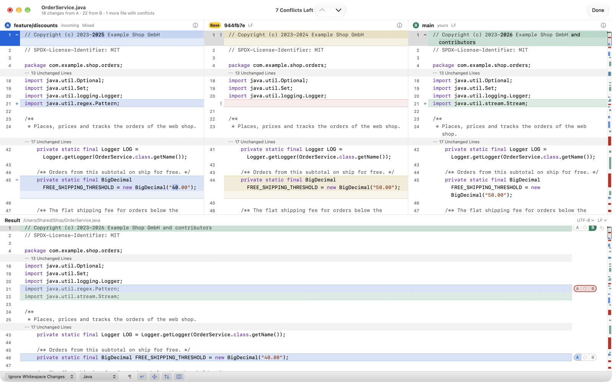
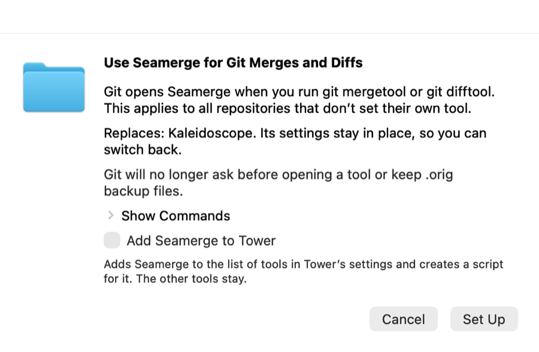
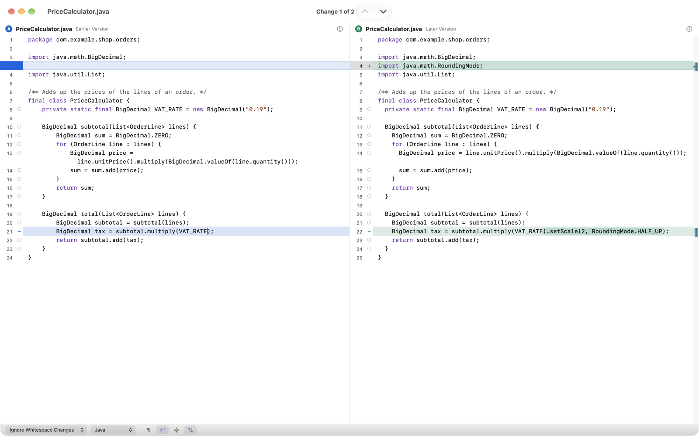
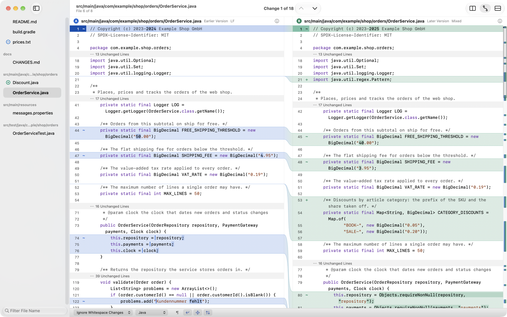
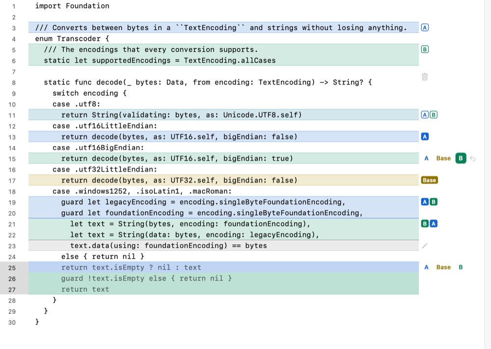
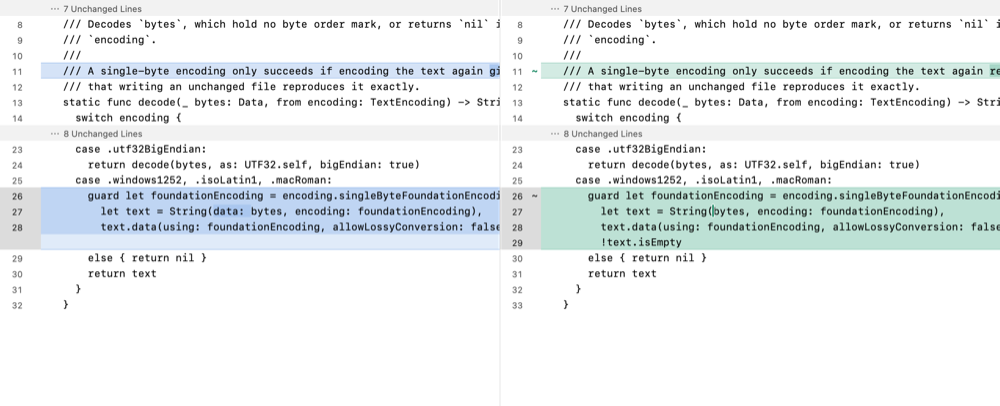
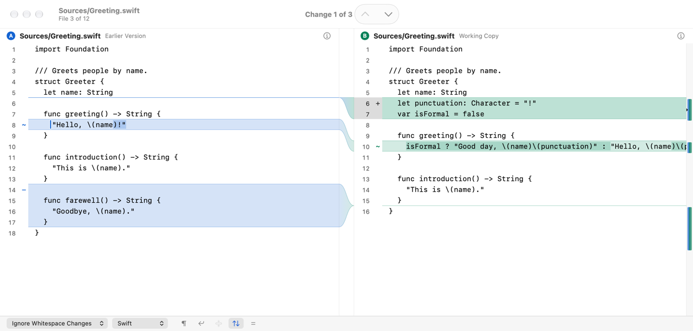
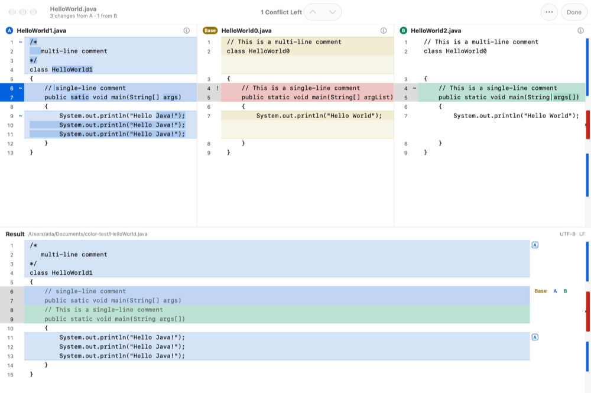
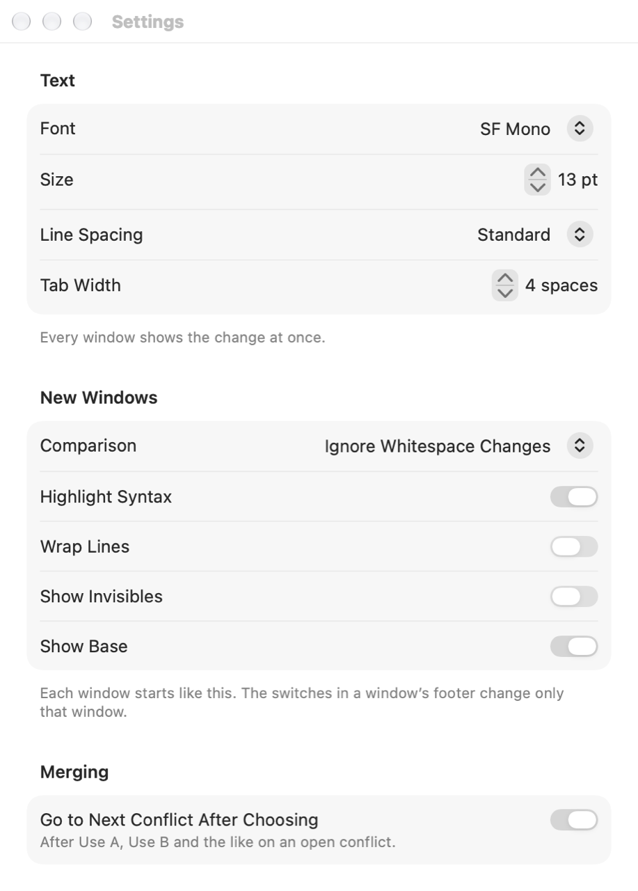
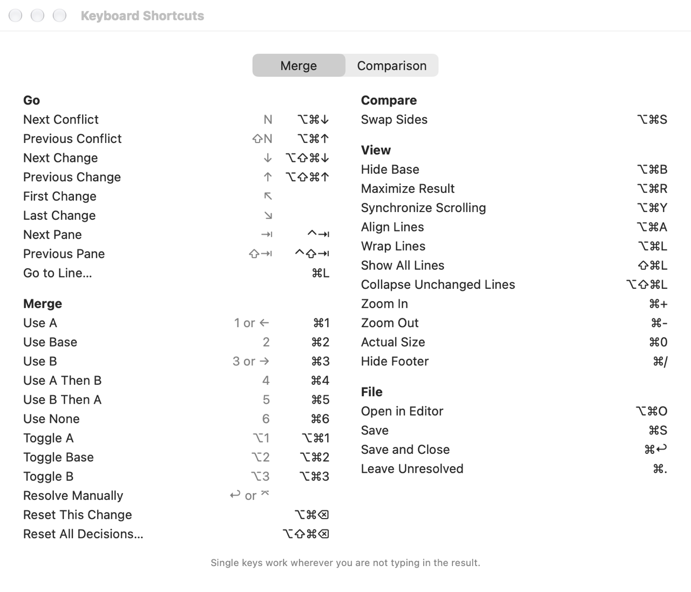

# Seamerge

**A native diff and merge tool for macOS, built for Git.**

Seamerge shows two files side by side, or a three-way merge with its base, and lets you choose what goes into the result block by block.

<picture>
  <source media="(prefers-color-scheme: dark)" srcset="Documentation/Images/hero-merge-dark.png">
  
</picture>

### Features

- **Git integration.** Set up once from the app, Seamerge runs as `git mergetool` and `git difftool`; Remove restores the Git configuration as it was.

  

- **Tower integration.** When Tower is installed, the same set-up adds Seamerge to Tower's diff and merge tools. In Tower, Seamerge also opens directory diffs.
- **Whitespace modes.** Compare exactly, ignore line endings, ignore changes in the amount of whitespace, or ignore all whitespace, chosen in the footer.

  <picture>
    <source media="(prefers-color-scheme: dark)" srcset="Documentation/Images/hero-whitespace-dark.png">
    
  </picture>
- **Several files in one window.** When Git or Tower compares several files of one run, Seamerge shows them in one window with a sidebar. `git difftool --dir-diff` compares two folders the same way.

  <picture>
    <source media="(prefers-color-scheme: dark)" srcset="Documentation/Images/hero-collection-dark.png">
    
  </picture>
- **Decisions per block.** The decision bar takes the text of A, the base, B, or both, or nothing, per block, with the mouse or single keys. A conflict stays open until you decide.

  

- **Collapsed unchanged lines.** Long stretches without changes fold into a bar that opens where you need it.

  

- **Syntax colors with a language choice.** Common languages are highlighted, and you choose the language in the footer or switch the highlighting off.
- **Line wrapping.** Wrap long lines in all panes, with the rows kept aligned.
- **Connected sides.** View ▸ Align Lines (`⌥⌘A`) joins the panes with bands that show which lines belong together, in a comparison and in a merge. Each side flows as continuous text with its own line numbers, and the bands connect the blocks that belong together.

  <picture>
    <source media="(prefers-color-scheme: dark)" srcset="Documentation/Images/connected-dark.png">
    
  </picture>
- **Encoding and line endings of the result.** Choose the encoding and the line endings the result is saved with.
- **Settings.** Choose the font, size, line spacing and tab width of the code, and how each new window starts. See [Settings](#settings).
- **Accessibility.** VoiceOver rotors for conflicts and changes, a window of all keyboard shortcuts, and support for Reduce Motion and Increase Contrast. See [Accessibility](#accessibility).

The toolbar counts the open conflicts or changes and moves between them.

  

Seamerge also keeps the panes aligned row by row and gives an editable result, where undo and redo cover text and decisions together.

## Requirements

- macOS 27.0 or later
- Xcode 27, with `xcodebuild`, to build from source. The Command Line Tools alone are not enough.

## Install

### Release download

Download the latest release from [GitHub Releases](https://github.com/cykedev/seamerge/releases) and move `Seamerge.app` into your Applications folder. The app is signed and notarized.

### Build from source

Clone the repository, enable the Git hooks in the clone, and install the app:

```bash
git clone https://github.com/cykedev/seamerge.git
cd seamerge
git config core.hooksPath Scripts/git-hooks
Scripts/install.sh
```

`Scripts/install.sh` builds the app in the Release configuration and copies it into `/Applications`. Add `--to <folder>` to install it somewhere else. The build needs Xcode 27 with `xcodebuild`; the Command Line Tools alone are not enough.

## Building and checking

To build and test one package:

```bash
swift test --package-path Packages/MergeEngine
```

`Scripts/check.sh` is the complete check. It lints the format of all Swift files, then builds and tests each package and the app, and prints one line per step. It exits with 0 only when every step passes. The full output is written to `.build/check.log`. `Scripts/check.sh --quick` checks the format and the build without the tests.

The `core.hooksPath` setting in the clone makes Git run the hooks in `Scripts/git-hooks`, which check the format of staged Swift files and the form of commit messages.

## Set up Git

Seamerge does not change your Git configuration until you ask it to:

1. Open Seamerge and choose **Seamerge ▸ Set Up Git Integration…**. The command is also in the window **Compare Files**, in the line that says whether Git opens Seamerge.
2. Review the text on the sheet. It names the tool it replaces, if any.
3. Click **Set Up**.

Seamerge then writes the entries for `merge.tool` and `diff.tool` to your global Git configuration. Git keeps the values it replaces, so **Remove** in the same sheet restores the configuration as it was.


If Tower is installed, the sheet also has **Add Seamerge to Tower**. Tick it before you click **Set Up**. Then restart Tower, and in Tower's settings, under Git Config, choose Seamerge as the diff tool and as the merge tool. To compare folders in Tower, turn on **Perform directory diff**.

## Try it with the example

The `Examples` folder holds one Java file in three versions (`Base`, `A` and `B`) and a script that makes a throwaway repository in which a merge stops with ten conflicts:

```bash
Examples/make-git-conflict.sh <directory>
```

The script prints two commands. The first, `git mergetool` with Seamerge, opens the conflicts. Choose the sides you want in each block, save, and close the window. The second, `git difftool`, compares the base with the branch in Seamerge. The commands pass their settings with `-c`, so they work without the Git integration being set up.

## Resolving a conflict

1. Jump to the next open conflict with `⌥⌘↓`.
2. Read A and B in their panes.
3. Choose in the pill, the three toggles of a block in the decision column: Use A (`⌘1`), Use Base (`⌘2`), Use B (`⌘3`), Use None (`⌘6`), or take both with Use A Then B (`⌘4`) or Use B Then A (`⌘5`).
4. Or type by hand: press Return in a pane above the result, then edit the block in the result.
5. Repeat for the open conflicts, or resolve them all with **Resolve All Open Conflicts with A or B** from the Merge menu.
6. Undo any step with `⌘Z`.
7. Finish with **Done** (`⌘↩`). Git takes the file as resolved. Close with **Leave Unresolved** (`⌘.`) to keep the conflict.

The [user guide](Documentation/UserGuide.md#resolving-a-conflict) explains each step.

## Settings

Choose **Seamerge ▸ Settings…** (`⌘,`) to change how the code looks and how new windows start. Changes to the text apply at once to every open window.

  <picture>
    <source media="(prefers-color-scheme: dark)" srcset="Documentation/Images/settings-dark.png">
    
  </picture>

- **Text:** the font of the code (SF Mono, or another monospaced font installed on the Mac), its size from 9 to 24 pt, the line spacing (compact, standard or spacious) and the tab width from 2 to 8 spaces. A window keeps the zoom you chose until the size in Settings changes.
- **New Windows:** how each new window starts: the comparison mode, and whether it highlights syntax, wraps lines, aligns the sides, shows invisible characters and shows the base. The switches in a window's footer change only that window.
- **Merging:** **Go to Next Conflict After Choosing**: whether a choice on an open conflict moves on to the next open conflict.

Each window opens where the last window of its kind was closed, with the size it had and, for a merge, the split above the result. Hiding the footer and the sidebar applies to all windows.

## Accessibility

- **VoiceOver** reads the panes, the controls and the decision bars by their labels, and announces changes of state. The rotors of a pane, **Conflicts** (in a merge) and **Changes**, move between the blocks without moving the current block.
- **Keyboard.** The menus show the shortcut of each command that has one, and **Help ▸ Keyboard Shortcuts** lists them in one window. The keys without Command or Option, such as `N` and `1`, work in a pane above the result, so you can read and decide without leaving the text.

  <picture>
    <source media="(prefers-color-scheme: dark)" srcset="Documentation/Images/keyboard-shortcuts-merge-dark.png">
    
  </picture>
- **Reduce Motion.** With Reduce Motion turned on in System Settings, a preview turns into text at once, without a transition.
- **Contrast.** The colors of the text, the bands and the borders are checked against their backgrounds in light and dark mode, with and without Increase Contrast. The border of a file field in Compare Files that accepts a drop stays visible with any accent color.

## Keyboard shortcuts

| Action | Shortcut |
|---|---|
| Take A, the base, B | ⌘1, ⌘2, ⌘3 |
| Take A then B, or B then A | ⌘4, ⌘5 |
| Take nothing | ⌘6 |
| Switch the source A, the base, B of a block on or off | ⌥⌘1, ⌥⌘2, ⌥⌘3 |
| Reset the current block | ⌥⌘⌫ |
| Reset all decisions | ⇧⌥⌘⌫ |
| Next or previous conflict | ⌥⌘↓, ⌥⌘↑ (in a pane above the result: N, ⇧N) |
| Next or previous change | ⇧⌥⌘↓, ⇧⌥⌘↑ in a merge; in a pane above the result ↓, ↑ |
| First or last change | Home, End in a pane above the result |
| Next or previous pane | ⌃Tab, ⇧⌃Tab |
| Undo, redo | ⌘Z, ⇧⌘Z |
| Next or previous file in a collection | ⌥⌘→, ⌥⌘← |
| Show or hide the sidebar | ⌃⌘S |
| Go to a line | ⌘L |
| Save | ⌘S |
| Save and close | ⌘↩ |
| Leave unresolved and close (merge) | ⌘. |
| Show or hide the base | ⌥⌘B |
| Align the sides with bands, or back to the grid | ⌥⌘A |
| Maximize the result | ⌥⌘R |
| Wrap lines | ⌥⌘L |
| Show all lines, or collapse unchanged lines | ⇧⌘L, ⌥⇧⌘L |
| Show or hide the footer | ⌘/ |
| Zoom in, zoom out, actual size (zoom steps from 9 to 24 pt) | ⌘+, ⌘-, ⌘0 |
| Settings | ⌘, |

The full list is in the menus and in the window **Help ▸ Keyboard Shortcuts**.

## Engine and license

The diff and merge engine is built on the Perforce Helix Core (p4) source, release 2025.1, patch 3079941, available at <https://ftp.perforce.com/perforce/r25.1/bin.tools/p4source.tgz>. The vendored code is in `Packages/MergeEngine/Sources/CMergeEngine/Vendor/Perforce`; [VENDORING.md](Packages/MergeEngine/VENDORING.md) describes what was taken over and what was changed.

Seamerge is licensed under the [MIT License](LICENSE). The vendored Perforce code is third-party code under its own license, found in [its license file](Packages/MergeEngine/Sources/CMergeEngine/Vendor/Perforce/LICENSE).

## Status and limits

The current release is Seamerge 0.2.0. It runs on macOS 27 only.

Read [CHANGELOG.md](CHANGELOG.md) for what changed in each release, and [CONTRIBUTING.md](CONTRIBUTING.md) if you want to work on the code. The [user guide](Documentation/UserGuide.md) describes the window in more detail, and [Documentation/Architecture.md](Documentation/Architecture.md) describes how the code is organized.
