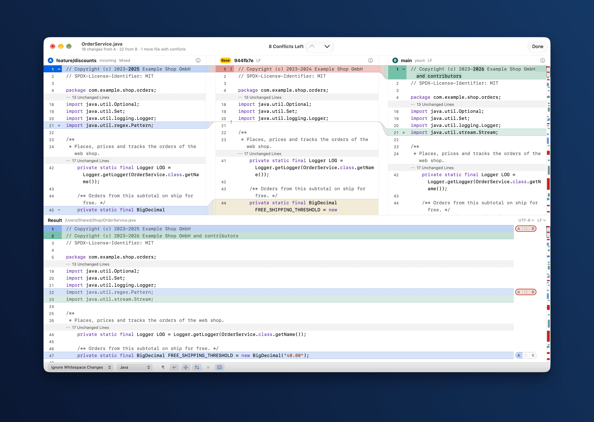
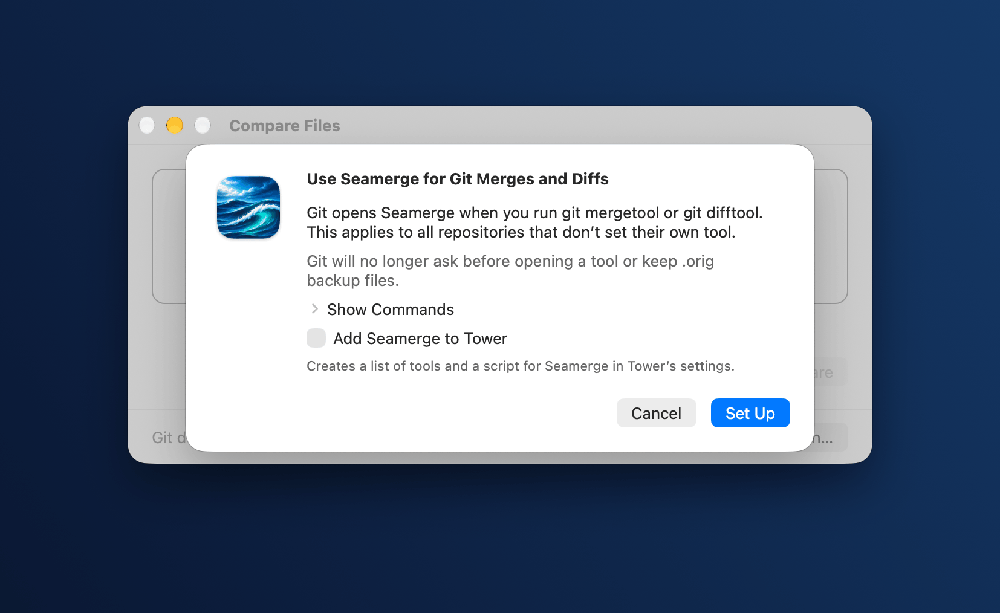
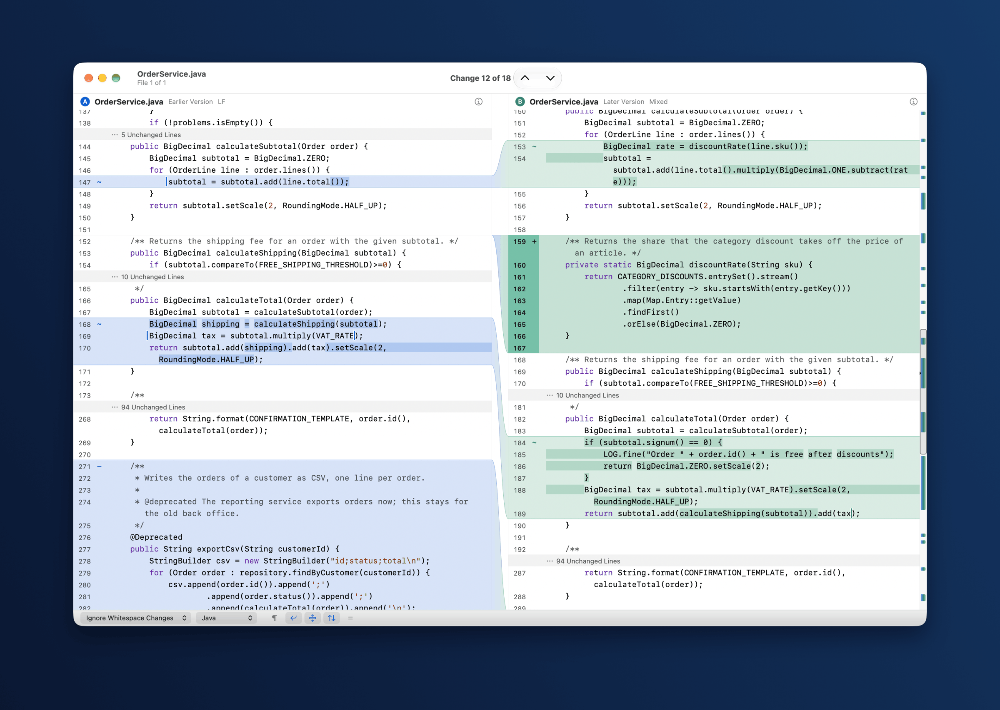
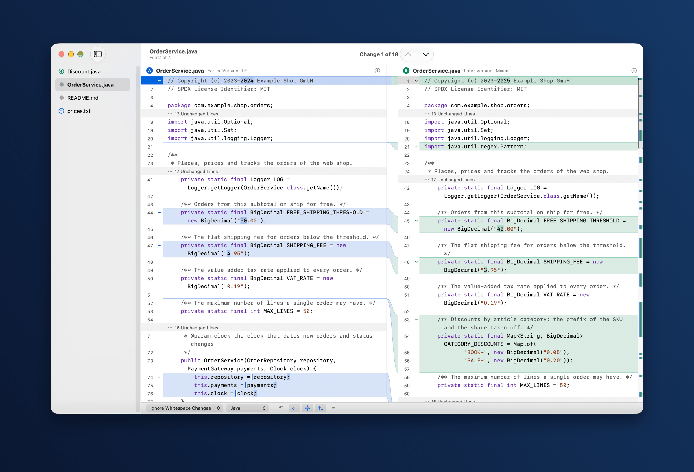
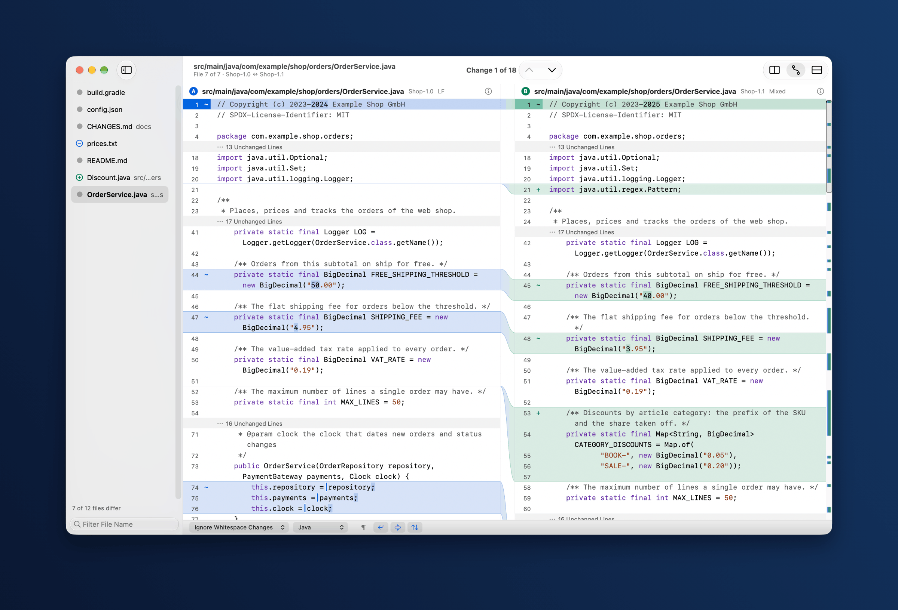
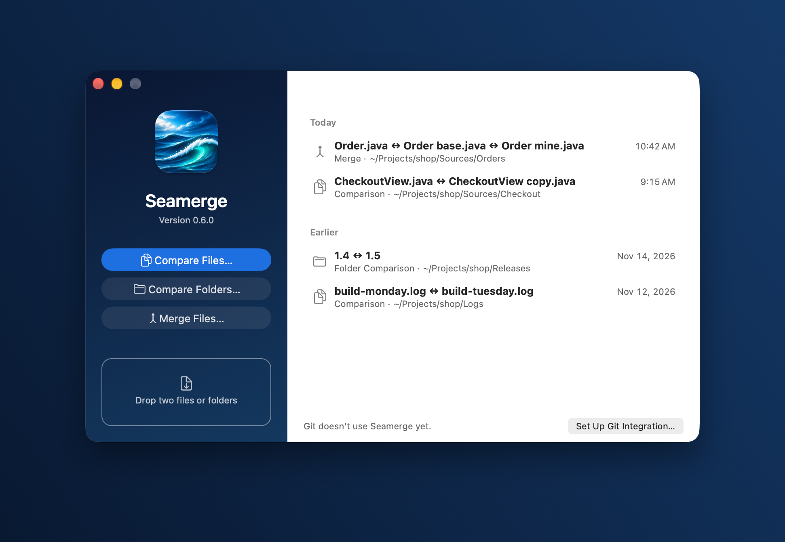
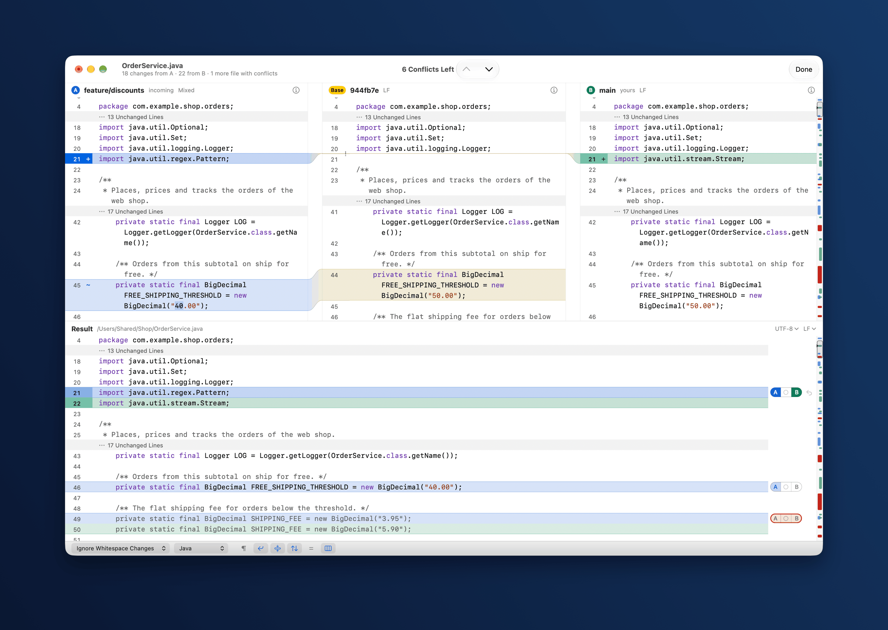
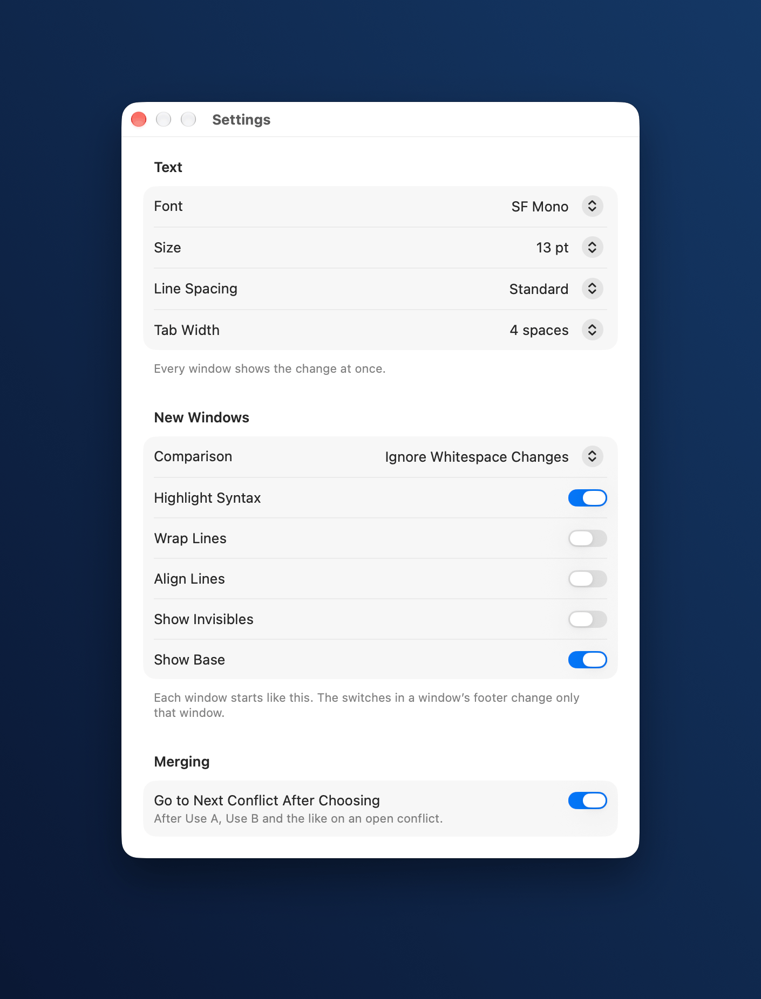
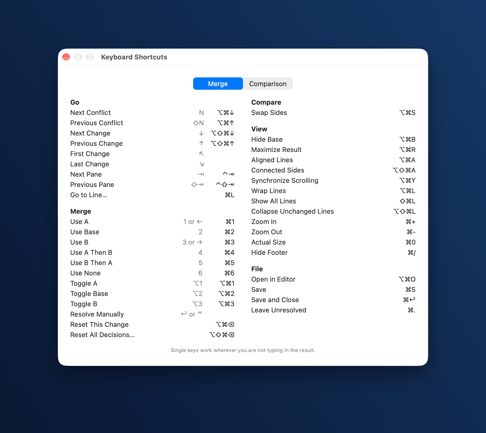

# Seamerge

**A native diff and merge tool for macOS, built for Git.**

Seamerge shows two files side by side, or a three-way merge with its base, and lets you choose what goes into the result block by block. It works with Git, and with Mercurial, Jujutsu, Subversion and Perforce as well; see [Other version control systems](Documentation/UserGuide.md#other-version-control-systems).

<picture>
  <source media="(prefers-color-scheme: dark)" srcset="Documentation/Images/screenshot-merge-dark.png">
  
</picture>

### Features

- **Git integration.** Set up once from the app, Seamerge runs as `git mergetool` and `git difftool`; Remove restores the Git configuration as it was.

  <picture>
    <source media="(prefers-color-scheme: dark)" srcset="Documentation/Images/screenshot-git-setup-dark.png">
    
  </picture>

- **Git-Tower integration.** When Git-Tower is installed, the same set-up adds Seamerge to Git-Tower's diff and merge tools. In Git-Tower, Seamerge also opens directory diffs.
- **Whitespace modes.** Compare exactly, ignore line endings, ignore changes in the amount of whitespace, or ignore all whitespace, chosen in the footer.

  <picture>
    <source media="(prefers-color-scheme: dark)" srcset="Documentation/Images/screenshot-whitespace-dark.png">
    
  </picture>
- **Several files in one window.** When Git or Git-Tower compares several files of one run, Seamerge shows them in one window with a sidebar that groups them by folder. `git difftool --dir-diff` compares two folders the same way.

  <picture>
    <source media="(prefers-color-scheme: dark)" srcset="Documentation/Images/screenshot-collection-dark.png">
    
  </picture>
- **Compare folders.** File ▸ Compare Folders… compares two folders in one window and lists the files that differ. A filter narrows the list by file name or folder.

  <picture>
    <source media="(prefers-color-scheme: dark)" srcset="Documentation/Images/screenshot-folders-dark.png">
    
  </picture>
- **Welcome window.** Start a comparison, a comparison of folders or a merge, or open one of the recent comparisons again, grouped into today and earlier. Two files or folders dropped on the window open at once.

  <picture>
    <source media="(prefers-color-scheme: dark)" srcset="Documentation/Images/screenshot-welcome-dark.png">
    
  </picture>
- **Moved blocks.** A block of lines that moved to another place gets an arrow at both ends that points to the other end; a click on the arrow, or Go ▸ Go to Other End of Move, jumps there.
- **Copying between the sides.** In a comparison, Copy to Right and Copy to Left take a change from one file into the other, and Save writes the files that changed. See [Copying changes between the sides](Documentation/UserGuide.md#copying-changes-between-the-sides).
- **Updates.** Seamerge checks for new versions with your consent and installs one only when you choose to. See [Updates](#updates).
- **Decisions per block.** The decision bar takes the text of A, the base, B, or both, or nothing, per block, with the mouse or single keys. A conflict stays open until you decide.

  <picture>
    <source media="(prefers-color-scheme: dark)" srcset="Documentation/Images/screenshot-decisions-dark.png">
    
  </picture>

- **Unfinished merges come back.** A merge that you close before you finish keeps your decisions and typed text on this Mac, and they return when the same merge opens again. See [Picking up an unfinished merge](Documentation/UserGuide.md#picking-up-an-unfinished-merge).
- **Text from the clipboard.** Compare text you copied, with Edit ▸ Paste in the sheet Compare Files. See [Comparing text from the clipboard](Documentation/UserGuide.md#comparing-text-from-the-clipboard).
- **Collapsed unchanged lines.** Long stretches without changes fold into a bar that opens where you need it.
- **Syntax colors with a language choice.** Common languages are highlighted, and you choose the language in the footer or switch the highlighting off.
- **Line wrapping.** Wrap long lines in all panes, with the rows kept aligned.
- **Line arrangement.** The toolbar segment Aligned Lines · Connected Sides · Single Column chooses how the lines are laid out. Aligned Lines (`⌥⌘A`) keeps matching lines at the same height. Connected Sides (`⌥⇧⌘A`) shows each side as continuous text, joined by bands that show which lines belong together, in a comparison and in a merge. Single Column (`⌥⌘U`) shows a comparison in one column.
- **Find and replace.** Find (`⌘F`) searches all panes of a window, and Find and Replace (`⌥⌘F`) in a merge replaces in the result only. Replace All is one undo step.
- **Ignore rules.** Settings ▸ Ignored Text holds rules for text that a comparison should leave out, such as timestamps, UUIDs and memory addresses, and your own patterns. Compare ▸ Use Ignore Rules applies them to a comparison.
- **Export as patch.** File ▸ Export as Patch… and Edit ▸ Copy as Patch write the changes as a unified diff. `git apply` takes the patch; see the [user guide](Documentation/UserGuide.md#export-as-patch).
- **Terminal command.** Seamerge ▸ Install Command Line Tool… installs `seamerge` in `/usr/local/bin`, so you can compare files and folders from Terminal.
- **Finder and Dock.** Select two or three files, or two folders, in Finder and choose Compare with Seamerge from the Services menu. Drop files or folders on the Seamerge icon in the Dock to fill the sheet Compare Files or Merge Files.
- **Encoding and line endings of the result.** Choose the encoding and the line endings the result is saved with.
- **Settings.** Choose the font, size, line spacing and tab width of the code, and how each new window starts. See [Settings](#settings).
- **Accessibility.** VoiceOver rotors for conflicts and changes, a window of all keyboard shortcuts, and support for Reduce Motion and Increase Contrast. See [Accessibility](#accessibility).

The toolbar counts the open conflicts or changes and moves between them.

Seamerge also keeps the panes aligned row by row and gives an editable result, where undo and redo cover text and decisions together.

## Requirements

- macOS 27.0 or later
- Xcode 27, with `xcodebuild`, to build from source. The Command Line Tools alone are not enough.

## Install

### Release download

Download the latest release from [GitHub Releases](https://github.com/cykedev/seamerge/releases) and move `Seamerge.app` into your Applications folder. The app is signed and notarized. Later versions can be installed from within the app; see [Updates](#updates).

### Homebrew

```bash
brew install --cask cykedev/tap/seamerge
```

The cask is published in the tap `cykedev/homebrew-tap` with each release. If Seamerge is already in your Applications folder, add `--adopt` so that Homebrew takes over that copy instead of refusing to install.

### Build from source

Clone the repository, enable the Git hooks in the clone, and install the app:

```bash
git clone https://github.com/cykedev/seamerge.git
cd seamerge
git config core.hooksPath Scripts/git-hooks
Scripts/install.sh
```

`Scripts/install.sh` builds the app in the Release configuration and copies it into `/Applications`. Add `--to <folder>` to install it somewhere else. The build needs Xcode 27 with `xcodebuild`; the Command Line Tools alone are not enough.

## Updates

Seamerge can check for new versions. The check needs your consent: after its second start, Seamerge asks whether it should check automatically. You can change the answer at any time in **Seamerge ▸ Settings…** under **Updates**, with **Check for Updates Automatically**. **Seamerge ▸ Check for Updates…** checks at once.

When a new version is found, Seamerge shows it and installs it only when you choose **Install and Relaunch**. The question waits while a comparison or merge started by Git is in front. While a Git command waits for Seamerge, the app does not restart; an update is then installed when you quit.

Updates are downloaded from GitHub. The [privacy policy](https://www.seamerge.app/about.html) describes what is sent.

Users of version 0.2.0 have no update check, so they download version 0.3.0 once from [GitHub Releases](https://github.com/cykedev/seamerge/releases).

## Building and checking

To build and test one package:

```bash
swift test --package-path Packages/MergeEngine
```

`Scripts/check.sh` is the complete check. It lints the format of all Swift files, then builds and tests each package and the app, runs the tests of the engine and of the core modules once more under the address, undefined behaviour and thread sanitizers, and prints one line per step. It exits with 0 only when every step passes. The full output is written to `.build/check.log`. `Scripts/check.sh --quick` checks the format and the build without the tests and the sanitizers.

The `core.hooksPath` setting in the clone makes Git run the hooks in `Scripts/git-hooks`, which check the format of staged Swift files and the form of commit messages.

## Set up Git

Seamerge does not change your Git configuration until you ask it to:

1. Open Seamerge and choose **Seamerge ▸ Set Up Git Integration…**. The command is also in the welcome window, in the line that says whether Git opens Seamerge.
2. Review the text on the sheet. It names the tool it replaces, if any.
3. Click **Set Up**.

Seamerge then writes the entries for `merge.tool` and `diff.tool` to your global Git configuration. Git keeps the values it replaces, so **Remove** in the same sheet restores the configuration as it was.

<picture>
  <source media="(prefers-color-scheme: dark)" srcset="Documentation/Images/screenshot-git-setup-dark.png">
  
</picture>

If Git-Tower is installed, the sheet also has **Add Seamerge to Tower**. Tick it before you click **Set Up**. Then restart Git-Tower, and in Git-Tower's settings, under Git Config, choose Seamerge as the diff tool and as the merge tool. To compare folders in Git-Tower, turn on **Perform directory diff**.

## Terminal and Finder

**Seamerge ▸ Install Command Line Tool…** puts a `seamerge` command into `/usr/local/bin`. The app asks for an administrator password before it changes that folder, and **Remove Command Line Tool…** takes the command out again. With the command, you can compare two files or two folders from Terminal, for example `seamerge old.txt new.txt`. The app also recognizes a command that Homebrew has linked there.

In Finder, select files or folders and choose **Compare with Seamerge** from the Services menu. Two files open at once, with the older one on the left; two folders open in the folder comparison; three files fill the sheet Merge Files. Seamerge must be in the Applications folder, and it registers the service when it starts.

## Try it with the examples

The `Examples` folder holds one Java file in three versions (`Base`, `A` and `B`) and a script that makes a throwaway repository in which a merge stops with ten conflicts:

```bash
Examples/make-git-conflict.sh <directory>
```

The script prints two commands. The first, `git mergetool` with Seamerge, opens the conflicts. Choose the sides you want in each block, save, and close the window. The second, `git difftool`, compares the base with the branch in Seamerge. The commands pass their settings with `-c`, so they work without the Git integration being set up.

`Examples/Logs` holds two runs of a build log, in which almost every line differs only in its timestamp, a session UUID or a memory address:

```bash
seamerge Examples/Logs/build-monday.log Examples/Logs/build-tuesday.log
```

Turn on Timestamps, UUIDs and Memory Addresses in **Settings ▸ Ignored Text**, and only the lines that really changed remain.

## Resolving a conflict

1. Jump to the next open conflict with `⌥⌘↓`.
2. Read A and B in their panes.
3. Choose in the pill, the three toggles of a block in the decision column: Use A (`⌘1`), Use Base (`⌘2`), Use B (`⌘3`), Use None (`⌘6`), or take both with Use A Then B (`⌘4`) or Use B Then A (`⌘5`).
4. Or type by hand: press Return in a pane above the result, then edit the block in the result.
5. Repeat for the open conflicts, or resolve them all with **Resolve All Open Conflicts with A or B** from the Merge menu.
6. Undo any step with `⌘Z`.
7. Finish with **Done** (`⌘↩`). Git takes the file as resolved. Close with **Leave Unresolved** (`⌘.`) to keep the conflict.

The [user guide](Documentation/UserGuide.md#resolving-a-conflict) explains each step.

## Settings

Choose **Seamerge ▸ Settings…** (`⌘,`) to change how the code looks and how new windows start. Changes to the text apply at once to every open window.

  <picture>
    <source media="(prefers-color-scheme: dark)" srcset="Documentation/Images/screenshot-settings-dark.png">
    
  </picture>

- **Text:** the font of the code (SF Mono, or another monospaced font installed on the Mac), its size from 9 to 24 pt, the line spacing (compact, standard or spacious) and the tab width from 2 to 8 spaces. A window keeps the zoom you chose until the size in Settings changes.
- **New Windows:** how each new window starts: the comparison mode, and whether it highlights syntax, wraps lines, aligns the sides, shows invisible characters and shows the base. The switches in a window's footer change only that window.
- **Merging:** **Go to Next Change After Choosing**: whether a choice on an open conflict, or a copy with Copy to Right or Copy to Left, moves on to the next open conflict or change.
- **Ignored Text:** the rules for text that a comparison leaves out, with a field to try a rule on sample text. Three rules come with the app; each can be switched on or off.
- **Updates:** **Check for Updates Automatically**, see [Updates](#updates).

Each window opens where the last window of its kind was closed, with the size it had and, for a merge, the split above the result. Hiding the footer and the sidebar applies to all windows.

## Accessibility

- **VoiceOver** reads the panes, the controls and the decision bars by their labels, and announces changes of state. The rotors of a pane, **Conflicts** (in a merge) and **Changes**, move between the blocks without moving the current block.
- **Keyboard.** The menus show the shortcut of each command that has one, and **Help ▸ Keyboard Shortcuts** lists them in one window. The keys without Command or Option, such as `N` and `1`, work in a pane above the result, so you can read and decide without leaving the text.

  <picture>
    <source media="(prefers-color-scheme: dark)" srcset="Documentation/Images/screenshot-shortcuts-dark.png">
    
  </picture>
- **Reduce Motion.** With Reduce Motion turned on in System Settings, a preview turns into text at once, without a transition.
- **Contrast.** The colors of the text, the bands and the borders are checked against their backgrounds in light and dark mode, with and without Increase Contrast. The border of a file field that accepts a drop stays visible with any accent color, and the text on the blue of the welcome window keeps its contrast.

## Keyboard shortcuts

| Action | Shortcut |
|---|---|
| Take A, the base, B | ⌘1, ⌘2, ⌘3 |
| Take A then B, or B then A | ⌘4, ⌘5 |
| Take nothing | ⌘6 |
| Switch the source A, the base, B of a block on or off | ⌥⌘1, ⌥⌘2, ⌥⌘3 |
| Reset the current block | ⌥⌘⌫ |
| Reset all decisions | ⌥⇧⌘⌫ |
| Next or previous conflict | ⌥⌘↓, ⌥⌘↑ (in a pane above the result: N, ⇧N) |
| Next or previous change | ⌥⇧⌘↓, ⌥⇧⌘↑ in a merge; in a pane above the result ↓, ↑ |
| First or last change | Home, End in a pane above the result |
| Next or previous pane | ⌃Tab, ⇧⌃Tab |
| Undo, redo | ⌘Z, ⇧⌘Z |
| Copy to Right, Copy to Left (comparison; in a pane above the result →, ←) | ⌥⌘→, ⌥⌘← |
| Next or previous file in a collection | ⇧⌘], ⇧⌘[ |
| Filter the list of files | ⇧⌘F |
| Show or hide the sidebar | ⌃⌘S |
| Go to a line | ⌘L |
| Save | ⌘S |
| Save and close | ⌘↩ |
| Leave unresolved and close (merge) | ⌘. |
| Show or hide the base | ⌥⌘B |
| Find, Find and Replace (replaces in the result) | ⌘F, ⌥⌘F |
| Find Next, Find Previous | ⌘G, ⇧⌘G |
| Filter Files (list of files) | ⇧⌘F |
| Aligned Lines, Connected Sides, Single Column (comparison only) | ⌥⌘A, ⌥⇧⌘A, ⌥⌘U |
| Maximize the result | ⌥⌘R |
| Wrap lines | ⌥⌘L |
| Show all lines, or collapse unchanged lines | ⇧⌘L, ⌥⇧⌘L |
| Show or hide the footer | ⌘/ |
| Zoom in, zoom out, actual size (zoom steps from 9 to 24 pt) | ⌘+, ⌘-, ⌘0 |
| Settings | ⌘, |

The full list is in the menus and in the window **Help ▸ Keyboard Shortcuts**.

## Engine and license

The diff and merge engine is built on the Perforce Helix Core (p4) source, release 2025.1, patch 3079941, available at <https://ftp.perforce.com/perforce/r25.1/bin.tools/p4source.tgz>. The vendored code is in `Packages/MergeEngine/Sources/CMergeEngine/Vendor/Perforce`; [VENDORING.md](Packages/MergeEngine/VENDORING.md) describes what was taken over and what was changed.

Seamerge is licensed under the [MIT License](LICENSE). The vendored Perforce code is third-party code under its own license, found in [its license file](Packages/MergeEngine/Sources/CMergeEngine/Vendor/Perforce/LICENSE).

Seamerge checks for new versions with [Sparkle](https://sparkle-project.org), only after you agree; Sparkle is used under the MIT License, and its license is in the app's About window.

## Status and limits

The current release is Seamerge 0.9.0. It runs on macOS 27 only. Files of up to about 100,000 lines open in a third of a second; files of around 500,000 lines and lines of a few thousand characters work, but noticeably slower. The [user guide](Documentation/UserGuide.md#large-files) gives the figures.

Read [CHANGELOG.md](CHANGELOG.md) for what changed in each release, and [CONTRIBUTING.md](CONTRIBUTING.md) if you want to work on the code. The [user guide](Documentation/UserGuide.md) describes the window in more detail, and [Documentation/Architecture.md](Documentation/Architecture.md) describes how the code is organized.
